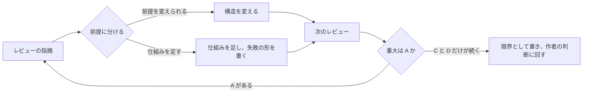

# 敵対的レビューで設計を直す進め方

info-hive の設計を、GPT-6.1 Sol の敵対的レビュー（`ask-codex` の `review`）で繰り返し直したときに分かったことである。セッションの取り込みの設計（7 回、[[セッションの取り込みの設計-2026-11-14]]）と、wiki の書く段の設計（15 回、[[wikiの書く段の設計-2026-11-15]]）の 2 つで確かめた。

## 分かったこと

- **状態を推す作りは、レビューのたびに崩れる。** 済んだかどうか、許された編集か、を今の中身からあとで推す作りは、照らし方を変えるたびに新しい反例が出た。安全に関わる事実を、書き手が作った結果（日誌、承認したハッシュ、位置だけの決定）として持つと、その形の反例は出なくなった。2 つの設計の両方で、この直しが最後まで崩れなかった。
- **直しで足した仕組みから、次の指摘が出る。** 書く段の設計では、3 回目から 15 回目まで、重大の指摘はほとんどが前の回の直しで足した仕組みから出た。そこで、直しで仕組みを足すときは、その仕組みが新しく生む失敗の形を、設計書に一緒に書くようにした（作者の指示）。
- **仕組みを足し続けるより、前提を変える。** 書く段の設計で、ロックを PC に 1 つにして wiki の印で管理領域を決める形は、印の直しを 3 回重ねても崩れ続けた。作者の判断でロックを wiki ごとにすると、印の仕組みそのものが要らなくなった。raw の守りも、集め方を直し続けるのをやめ、守り方を組み立て直した。
- **重大の指摘を発生の度合いで分けると、止める判断ができる。** A（仕様の矛盾か欠落で、実装すれば必ず踏む）、B（日常の使い方で起きうる）、C（まれな時機や名前）、D（作為的な配置が要る）に分ける。A は作り直した直後にだけ出て、そのあとは C と D が残り続けた。

> Claude Opus 5.5 補足: 図は、指摘を受けてから、構造を変えるか仕組みを足すかを選び、次のレビューの重大の種類で、続けるか止めるかを決める流れである。A は実装すれば必ず踏む欠陥、C と D はまれな時機や作為的な配置が要る欠陥を指す。

## 使い方

- 指摘を 1 件ずつ塞がず、前の版が暗に置いていた前提を書き出し、どの指摘がどの前提から出たかを対応づけてから直す（設計書の「N 回目のレビューで崩れた前提」の表）。
- 直しで仕組みを足したら、その仕組みが生む失敗の形を表にし、限界は「保証しないこと」に書く。
- 版とレビューは `docs/agent-runs/` に残し、回ごとの重大の数と発生の度合いを `summary.md` に書く。
- 重大が C と D だけになり、同じ境目（書く段の設計では raw の守り）で見つかり続けたら、止めるかを作者に聞く。止めたときは、レビューを受けていない直しと、残る危うさを設計書と ADR に書き、実装のときの試験とレビューで確かめる。
