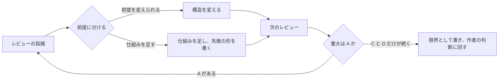

# 敵対的レビューで設計を直す進め方

info-hive の設計を、GPT-6.1 Sol の敵対的レビュー（`ask-codex` の `review`）で繰り返し直したときに分かったことである。セッションの取り込みの設計（7 回、[[セッションの取り込みの設計-2026-11-14]]）と、wiki の書く段の設計（15 回、[[wikiの書く段の設計-2026-11-15]]）の 2 つで確かめた。raw の段の確かめのスクリプトの実装（15 回、[[rawの段の確かめの証拠の読み切りとレビューの打ち切り-2026-11-15]]）でも、同じことが起きた。

## 分かったこと

- **状態を推す作りは、レビューのたびに崩れる。** 済んだかどうか、許された編集か、を今の中身からあとで推す作りは、照らし方を変えるたびに新しい反例が出た。安全に関わる事実を、書き手が作った結果（日誌、承認したハッシュ、位置だけの決定）として持つと、その形の反例は出なくなった。2 つの設計の両方で、この直しが最後まで崩れなかった。YouTube の字幕の設計（3 回、[[youtubeの字幕の取り込みの設計-2026-11-15]]）でも、トラックの種類を名前から推す作りと、同一性に別名（トラックの名前）を使う作りが、続けて崩れた。YouTube が返す引数（`tlang` の有無）と原本のバイト列に替えると、崩れなかった。
- **直しで足した仕組みから、次の指摘が出る。** 書く段の設計では、3 回目から 15 回目まで、重大の指摘はほとんどが前の回の直しで足した仕組みから出た。そこで、直しで仕組みを足すときは、その仕組みが新しく生む失敗の形を、設計書に一緒に書くようにした（作者の指示）。YouTube の字幕の設計でも、自動字幕の訂正の記録を足した 4〜7 回目は、重大がどれも記録の形（表の単位、出現の指し方、印の読み方）から出た。字幕の行にスクリプトが振る番号を識別子にすると、8 回目で採用可になった（[[youtubeの字幕の取り込みの設計-2026-11-15]]）。
- **仕組みを足し続けるより、前提を変える。** 書く段の設計で、ロックを PC に 1 つにして wiki の印で管理領域を決める形は、印の直しを 3 回重ねても崩れ続けた。作者の判断でロックを wiki ごとにすると、印の仕組みそのものが要らなくなった。raw の守りも、集め方を直し続けるのをやめ、守り方を組み立て直した。
- **別名の仕組みを 1 つずつ禁じるより、守りたい性質を直接確かめる。** 2 つの wiki を引く設計（7 回、[[2つのwikiを引く問い合わせの設計-2026-11-16]]）では、2 つの wiki が実体を分け合わないことを、根のパス、ページ、ディレクトリで代わりに確かめるたびに、ハードリンク、ファイルのシンボリックリンク、bind mount、NFC の正規化と、別の仕組みで崩れた。根の下の実体の識別子を全部比べる形に替えると、仕組みの種類によらず見つかるようになった（[[2つのwikiの分離の確かめ方]]）。
- **重大の指摘を発生の度合いで分けると、止める判断ができる。** A（仕様の矛盾か欠落で、実装すれば必ず踏む）、B（日常の使い方で起きうる）、C（まれな時機や名前）、D（作為的な配置が要る）に分ける。A は作り直した直後にだけ出て、そのあとは C と D が残り続けた。
- **直す前の版から、独立に修正案を作ってもらうと、直しの漏れが見つかる。** 確かめのスクリプトの 14 回目の指摘を直したあと、Sol に直す前の版だけを渡して修正案を作ってもらった。中心の直しは一致したが、Sol の案は直しの原則を広げていて、照らすと、先の直しに 3 つの穴が残っていた。直した版を見せてレビューを頼むより、直しの考え方そのものの漏れが見えた。
- **場合を並べた表は、もれと重なりを生む。** `/wiki:query` の確からしさの規則（[[queryの確からしさとリリース-wiki-0.20.0]]）で、前提の出発点をページの種類で並べたところ、`log.md` を根拠にする回答がどの行にも当たらなかった。検索の縮退の理由は、理由を表さない欄（`index.state`）から推したので、2 つの理由が同時に当たった。どの表も上から順に見て最初に当たった行を取る形にし、最後に「どれにも当たらない」の行を置くと、その形の反例は出なくなった。
- **決まりを当てる単位を、抜け道のない単位にする。** 同じ規則で、「wiki の外の知識を添えない」を質問全体の単位で書くと、「A と B は？」のように問いをまとめるだけで、wiki が扱っていない B を外の知識で埋められた。結論ごとに当てる形にすると崩れなかった。
- **文書を読み比べるレビューは、規則がエージェントに届くかを確かめない。** `/wiki:query` の確からしさの規則は、Sol の 6 回のレビューで文書の中のもれと重なりを直した。ところが Sonnet 5.5 で 33 回流すと、規則の正本の手順 5b を開いた回は 0 回だった。エージェントは、コマンドの短い要約だけで判定し、要約の「など」や言い回しから規則にない上限を作った（[[queryの確からしさのsonnetでの測定-2026-11-16]]）。エージェントに従わせる規則は、レビューとは別に、実際のモデルで流して確かめる。
- **指摘の条件が、実際の記録で起きたかを数える。** 確かめのスクリプトでは、実際の取り込みの記録 4 件で、11〜15 回目の指摘の条件を数えた。指摘の前提（W8 をほかのコマンドと 1 つの呼び出しにまとめる）は 4 回とも起きたが、欠陥になる細かい条件は 1 回も起きていなかった。発生の度合いの分け方（上の A〜D）を、推測でなく数えた事実で裏づけられ、作者が打ち切りを決めた。

> Claude Opus 5.5 補足: 図は、指摘を受けてから、構造を変えるか仕組みを足すかを選び、次のレビューの重大の種類で、続けるか止めるかを決める流れである。A は実装すれば必ず踏む欠陥、C と D はまれな時機や作為的な配置が要る欠陥を指す。

## 使い方

- 指摘を 1 件ずつ塞がず、前の版が暗に置いていた前提を書き出し、どの指摘がどの前提から出たかを対応づけてから直す（設計書の「N 回目のレビューで崩れた前提」の表）。
- 直しで仕組みを足したら、その仕組みが生む失敗の形を表にし、限界は「保証しないこと」に書く。
- 版とレビューは `docs/agent-runs/` に残し、回ごとの重大の数と発生の度合いを `summary.md` に書く。
- 指摘を直して PR に入れたら、直す前の版だけを渡して、独立に修正案を作ってもらい、直した版と照らすことを考える（直した版とその後の履歴は読まないように頼む）。
- 実装が実際に動いた記録（セッションの記録、試験の結果）があれば、重大の指摘の条件が、そこで何回起きたかを数え、`docs/agent-runs/` に数え方とともに残す。
- 重大が C と D だけになり、同じ境目（書く段の設計では raw の守り）で見つかり続けたら、止めるかを作者に聞く。止めたときは、レビューを受けていない直しと、残る危うさを設計書と ADR に書き、実装のときの試験とレビューで確かめる。
