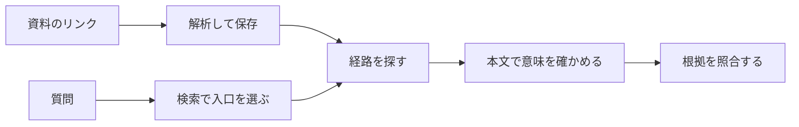

# 既存リンクからのグラフ検索

既存のリンクをグラフの辺として解析し、関連する文書を探す方式。[[build-an-agentic-knowledge-graph-from-scratch-ja]] の設計では、意味のある関係かどうかを本文で確かめる段が必要になる。

> GPT-6 補足: 検索、経路、本文の確認を分けて描いた。この記事の設計を整理したもので、全工程の動作確認を表す図ではない。

## 適用の境界

リンクが乏しければ抽出を補う必要がある。また、探索範囲内に経路がないことから、現実の関係の不存在は結論できない。辺の欠落やハブによる弱い接続にも注意する。

この wiki で型付きの関係を追加する条件は、[[グラフの抽出の契約]] とスキーマに従う。外部の記事で示された方式を、info-hive が実装済みだとは解釈しない。

## 関係するページ

- [[build-an-agentic-knowledge-graph-from-scratch-ja]]: 設計と検証範囲の出典
- [[エージェントに守らせる決まりの書き方]]: 回答の生成と採否の判定の分担
