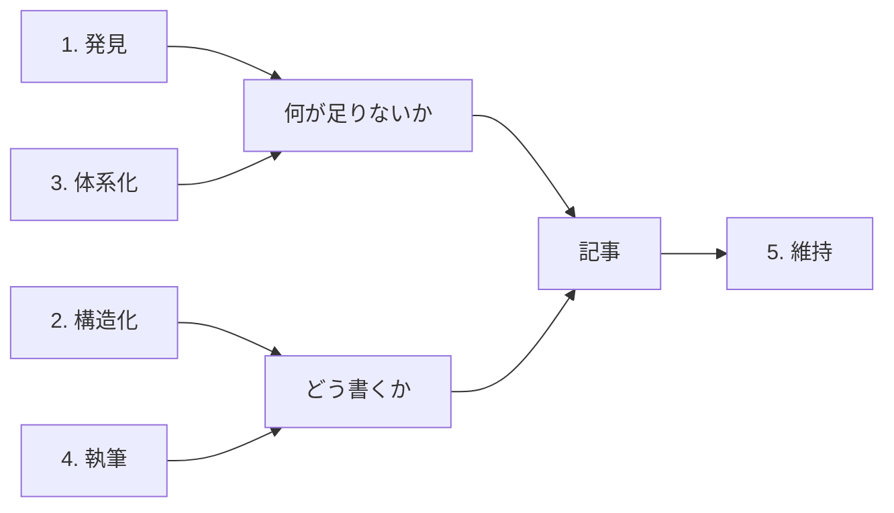

# 記事作成の 5 区分

LLM Wiki の記事作成を、発見、構造化、体系化、執筆、維持の 5 つの別々の問題に分ける整理である。1 つの手法ですべてを解こうとせず、区分ごとに手法を選んで組み合わせる。[[llm-wiki記事作成の方法論]] が、手法を網羅するためではなく、どの状況でどの手法を使い、どれを使わないかを決めるための骨格として提案している。ソースは、ChatGPT の回答による KM 理論の整理をこの骨格に使ったと書いている（その回答自体は手元にない）。

## 区分と手法

| 区分 | 問い | 先に採る手法 | 後回しにする手法 |
| --- | --- | --- | --- |
| 1. 発見 | 何について書くか | Source-driven ingest、Query-driven | Competency Questions（領域が見えてから） |
| 2. 構造化 | どの単位に分けるか | Atomic Notes とページの種類（source、concept、entity、decision） | DITA |
| 3. 体系化 | どう分類し、関連付けるか | MOC（`index.md`）、SKOS 風の relations | Taxonomy の事前設計、OWL や完全なオントロジー |
| 4. 執筆 | どう書くか | テンプレートと出典の必須、ADR | Diátaxis の 4 種の完全な適用 |
| 5. 維持 | 重複、矛盾、陳腐化をどう防ぐか | lint、status、Docs as Code | KCS（利用が増えてから） |

区分ごとの手法の候補は、表に挙げたものより多い。たとえば発見には Gap Analysis と Task-driven、維持には Single Source of Truth と暫定から正典への昇格、日誌の定期統合も挙がっている。

> Claude Opus 5.5 補足: 5 つの区分の役割の分担を示す。発見と体系化が何が足りないかを決め、構造化と執筆がどう書くかを決める。維持は、書いたあとの記事を支える。

## きっかけで手法を選ぶ

ソースは、記事が生まれるきっかけが手法を決めるとし、きっかけごとに使う手法と使わない手法を対応させている。主なものは次のとおりである。

| きっかけ | 使う手法 | 使わない、後回しにする手法 |
| --- | --- | --- |
| 未知の領域を学び始めた | ボトムアップ。ソースを取り込み、Atomic Notes で概念のページを生やす | Taxonomy の事前設計、Competency Questions（まだ問いが立たない） |
| 既知の領域を網羅したい | Competency Questions で問いを並べ、MOC に赤リンクを置き、Gap Analysis で埋める | 日誌から育てる（遅すぎる） |
| 外部のソースを続けて取り込む | 取り込み、出典の必須、暫定から正典への昇格。raw は変えない | 正典のページへ直接書き込む |
| 質問に答えた | Query-driven と KCS。回答を下書きの記事にし、答えられなかった問いを残す | — |
| 日々のタスクとアイデア | 日誌に書き、週ごとの統合で概念のページへ上げる | 毎回 Atomic Note にする（雑音が増える） |
| 手順が主の技術知識 | Diátaxis で How-to と Reference を分ける | 概念が中心の領域では、種類を explanation だけにしてよい |

このほかに、個別プロジェクトの知識、定期の保守、ナレッジグラフにする準備の 3 つのきっかけも挙がっている。

## Skill への落とし込み

ソースの Skill の設計では、区分ごとに置き場所を変える。

- 区分 1 のきっかけごとに、コマンドを分ける（ingest、plan、answer、journal など）。
- 区分 2 から 4 は、共通のスキーマとテンプレートで固定する。
- 区分 5 は、lint と consolidate にまとめる。

info-hive のいまのコマンド（`/wiki:ingest`、`/wiki:query`、`/wiki:lint` など）との違いは、[[llm-wiki記事作成の方法論]] の「info-hive の現状との差」に書いた。
