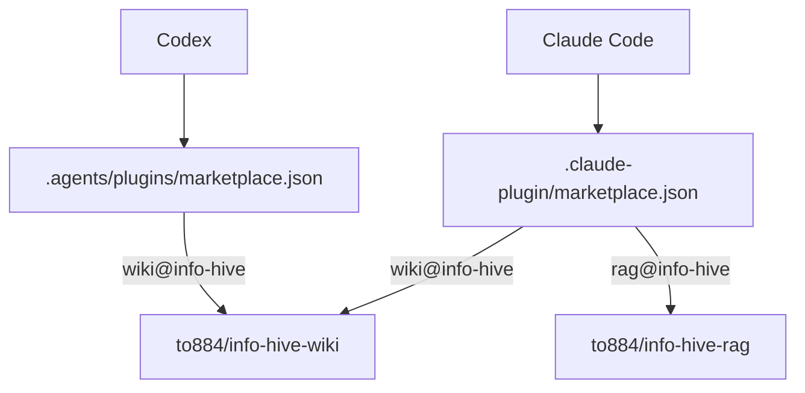
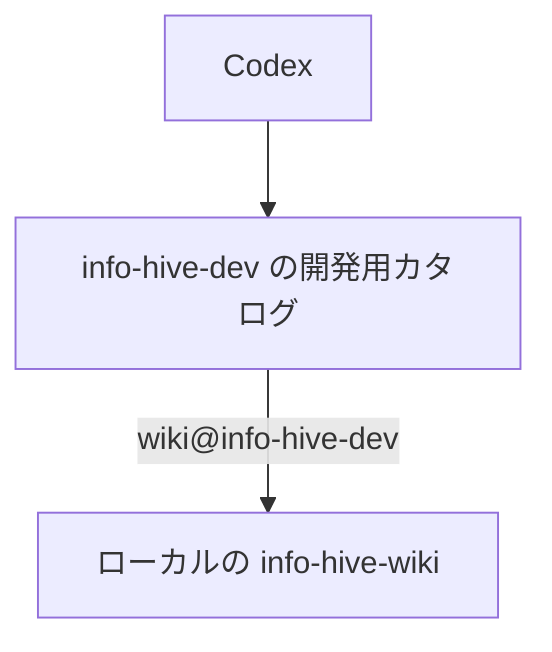

# info-hive-marketplace

`to884/info-hive-marketplace` は、各プラグインの取得先を定義する `info-hive` の公開カタログを置くリポジトリ。以下はコミット `c709eb3` の構成。[[info-hive-marketplaceの配布構成-c709eb3]]

## Claude Code と Codex の公開配布

配布先のプラグインと実行時の PDF 取り込みは [[info-hiveの配布と実行の全体図]] で続けてたどれる。

> Codex 補足: 両カタログは `to884/info-hive-marketplace` にあり、カタログ名はどちらも `info-hive`。Claude Code は wiki と rag を掲載し、Codex は wiki のみを掲載する。矢印のラベルは導入時の名前。

- Claude Code のカタログは、各プラグインを `source: "github"` と `repo` で指定する。[[info-hive-rag]] は `wiki@info-hive` に依存する。
- Codex のカタログは、[[info-hive-wiki]] を `source: "url"` と `https://github.com/to884/info-hive-wiki.git` で指定する。
- バージョンは各取得先のプラグイン定義 `plugin.json` で管理する。

## Codex の開発用カタログ

> Codex 補足: 親リポジトリの `info-hive-dev/.agents/plugins/marketplace.json` は、`source: "local"` で `./info-hive-wiki` を参照する。作業ツリーの変更を試すときに使う。
