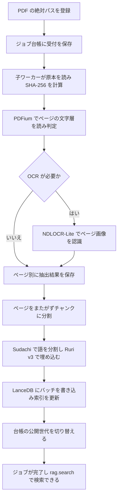
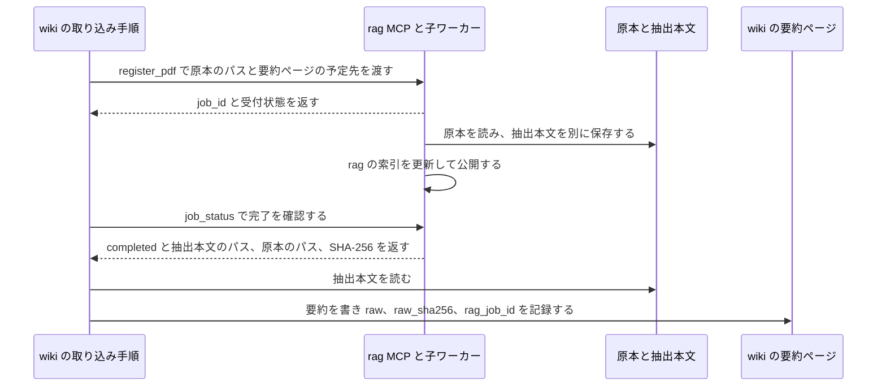

# info-hive-rag

PDF を原本の場所に置いたまま処理し、ページ番号と出典を返すローカル検索を提供する Claude Code プラグイン。ここでは親リポジトリが参照する rag のコミット `4fabe32` と、wiki v0.38.1 の連携を扱う。[[info-hive-ragのアーキテクチャ-4fabe32]]

Claude Code 用の公開カタログで `rag@info-hive` として配布される。掲載先は [[info-hive-marketplace]]、導入時の依存関係から PDF 取り込みまでの流れは [[info-hiveの配布と実行の全体図]] を参照。

## PDF の登録から索引の公開まで

設定、進捗確認、PDF 内検索の書式は [[ragのコマンド一覧-4fabe32]] を参照。

> Codex 補足: 新規 PDF の正常系。登録結果の `queued` は受付済みを表す。ワーカーはページと埋め込みバッチの途中経過を保存し、再開時に使う。検索は台帳に載った世代を使う。図の OCR 分岐は既定の `auto` を示す。

- **ジョブと再開**。接続中は同じ保存先につき一つの子ワーカーが処理する。未完了ジョブと進捗は `jobs-v2.sqlite` に残る。失敗・キャンセル後は明示的に再試行する。
- **成果物の保存先**。ページ別の JSON と抽出本文 `document.md` は、PDF のハッシュと抽出条件を鍵に共有する。検索用の LanceDB と公開世代を持つ `catalog.sqlite` は wiki ごとに分かれる。

## info-hive-wiki との連携

> Codex 補足: PDF は元の場所に置く。rag が検索用の索引と抽出本文を用意し、wiki のエージェントは抽出本文から出典付きの要約を書く。PDF 内のチャンクは `rag.search`、wiki の Markdown 記事は `wiki.query` で探す。

同じ場所の PDF が別の内容に置き換わると、rag は旧版を出典とする wiki ページに `review_required` を付ける。wiki の Markdown を検索・閲覧する側の構成は [[info-hive-wiki]] を参照。

## 全量 OCR 後の検証

905 文書・22,335 OCR ページを含む入力で、全量 ANN の自動作成・追加時の更新と、公開直後を含む 3 回の中断・再開を確認した。
実 MCP 45 項目と元データの最終監査は成功し、公開後の旧世代の回収と再開位置の不具合を修正した。
この結果は `4fabe32` に未コミットの修正を加えた状態のもので、検証範囲は [[rag全量ocr後のann保守と中断再開-2026-11-19]] にある。
残った 2 件のキャッシュ管理の問題は後続で修正し、実 MCP 21 項目で OCR の再利用と不要キャッシュの回収を確認した。[[ragのocrキャッシュの再利用と回収-2026-11-20]]

## 0.5.4 の公開

キャッシュの修正を 0.5.4 として main にマージし、タグ、GitHub リリース、公開マーケットプレイスからの新規導入を確認した。[[rag-0.5.4の公開と導入確認-2026-11-20]]
