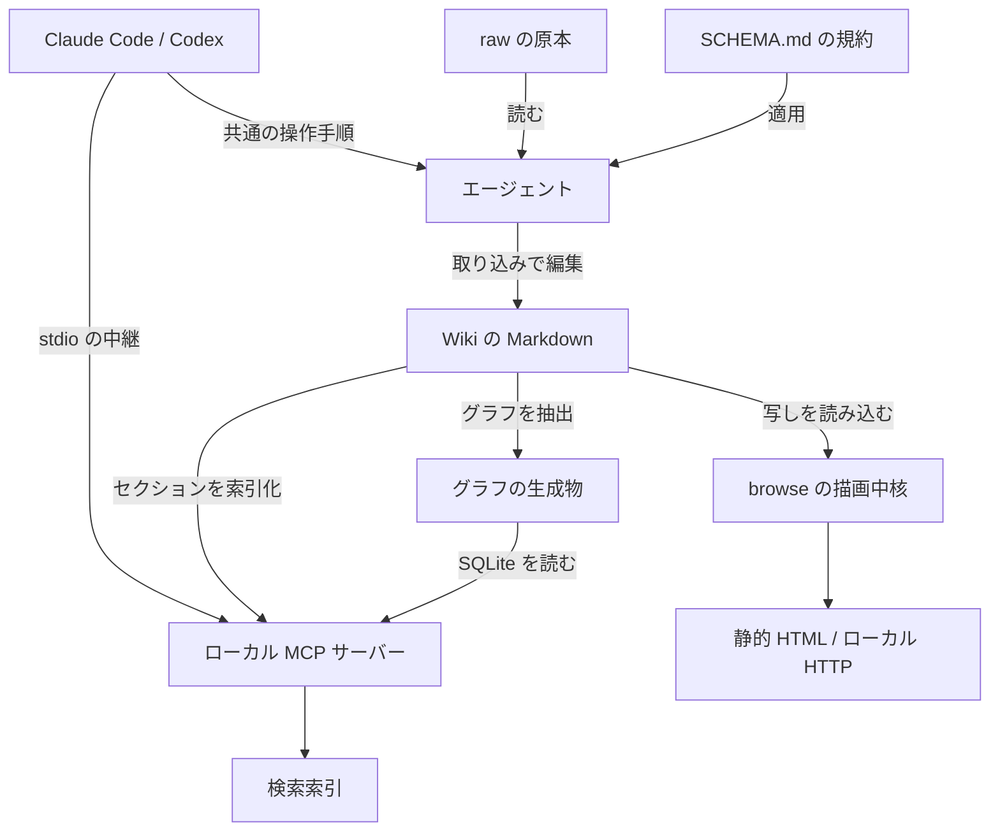

# info-hive-wiki

Claude Code と Codex で、資料を出典付きの日本語 Markdown に整理するプラグイン。以下の構成はタグ v0.38.1 の実装をもとにしている。[[info-hive-wikiのアーキテクチャ-v0.38.1]]

両ホストの公開カタログでは `wiki@info-hive` として配布される。取得先と開発用の導入経路は [[info-hive-marketplace]]、rag と連携するまでの流れは [[info-hiveの配布と実行の全体図]] を参照。

## アーキテクチャ

Claude Code と Codex での使い方は [[wikiのコマンド一覧-v0.38.1]] を参照。

> Codex 補足: 原本と wiki の規約を参照して、エージェントが Markdown を更新する。その Markdown が検索、グラフ、閲覧の入力になる。MCP の中継と browse の HTTP 表示は別の経路で動く。

- **入口と正本**。Claude Code の `/wiki:*` と Codex の `$wiki:info-hive` は `commands/*.md` の操作手順を共用する。利用者が選んだ原本を raw に置き、編集した記事を `wiki/` に置く。ルートの `SCHEMA.md` が記事の種類や運用規約を定める。[[初期化されたwikiの判定]]
- **検索**。複数のセッションから接続するローカル MCP サーバーが、語彙索引とベクトル索引をまとめて管理する。MCP を利用できない場合は、別のローカル索引を使う CLI で検索できる。
- **v0.39.0 の MCP**。検索、記事の取得、点検、統計、グラフ照会と外部チャンクの索引化を提供する。ツールごとの入出力と版の指定は [[wikiのmcpサーバーの仕様-v0.39.0]] を参照。
- **Windows での起動診断**。v0.39.1 は Visual C++ ランタイムがない Windows で、DLL の読み込み失敗と導入コマンドを知らせる。新規 VM での `--ensure` の観測は [[wikiのwindows初期環境とmcp起動診断-2026-11-20]] を参照。
- **Claude Desktop の Code への導入**。新規 Windows VM でのマーケットプレイス同期、ローカル MCP の確認、`/wiki:help` の結果は [[claude-desktopへのwiki-0.39.1の導入-2026-11-21]] を参照。
- **Claude Cowork への導入**。チャットと Cowork の統合画面でのプラグインの追加とフォルダーの権限確認は [[claude-coworkへのwiki導入-2026-11-21]] を参照。
- **グラフ**。Markdown の関係とリンクを、オントロジーに沿って再生成可能なグラフにする。MCP の `graph` は生成済みの SQLite を使う。browse の関係表は同じ抽出関数を記事の写しに適用する。[[グラフの抽出の契約]]
- **閲覧**。browse は共通の描画中核の出力を、静的 HTML とローカル HTTP の二つの方法で提供する。Mermaid は静的版で SVG に書き出し、サーバー版では専用の枠で描画する。
- **Box Drive 上の wiki**。Windows 版の Cloud Files 方式では、1 台の PC で初期化から再編集までを確認した。複数端末で共有するときは、確定版のアーカイブや静的 HTML を配布する。[[box-drive上のwikiの運用]]
- **rag との連携**。PDF のパスを `register_pdf` に渡すと、[[info-hive-rag]] が抽出して自身の PDF 索引を更新する。エージェントは `job_status` で完了を確認し、抽出本文から原本への参照付きの要約ページを作る。wiki の MCP には、外部からチャンクを受け取り collection 別に保持する `index_chunks` もある。
