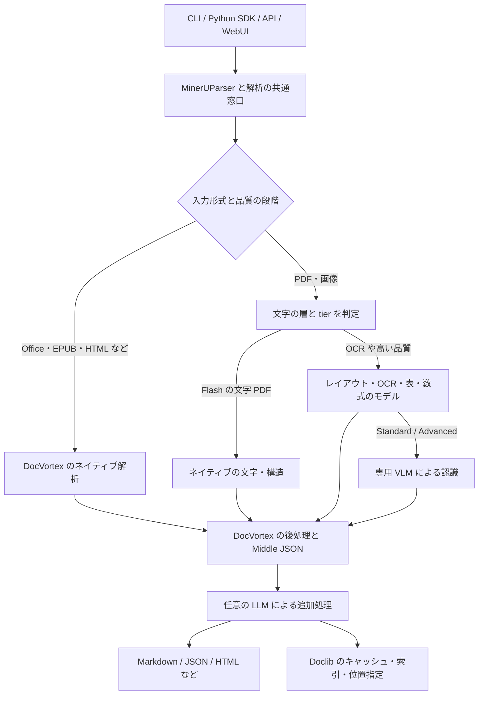

# MinerU

OpenDataLab が開発する文書解析ツール。PDF、スキャン画像、Office などから、本文、見出し、表、数式、図とその位置を抽出し、Markdown や JSON などへ変換する。2026-11-18 に確認したソフトウェアの版は **4.2.3**。根拠と固定コミットは [[mineru-readme]] にある。

4.x は変換だけでなく、ローカル文書ライブラリ、検索、解析キャッシュ、ページやブロック単位の継続閲覧、安定した出典位置を持つ。RAG では、検索の前に資料を読める形へ整える処理の候補になる。

## 特徴

- **構造を取り出す。** 文字の列だけでなく、表や数式、図、読み順を扱い、後段のモデルが解釈しやすい文書へ変える。9 種の出力先を共通の文書モデルから提供する。
- **文書に応じて処理を変える。** ネイティブの情報を利用する経路と OCR・専用モデル・VLM の経路を使い分け、速度、計算資源、品質を 4 段階で選べる。
- **閲覧と出典の追跡をつなぐ。** `doc:{short_id}/tier:{tier}/page:{page_no}/block:{block_no}` で後の閲覧と引用につなげ、4.2 の WebUI は原本と解析結果を相互にたどれる。
- **ローカルに配置できる。** 小型モデルの ONNX/Torch と、VLM の llama.cpp/vLLM/LMDeploy などを独立して選べる。文書ライブラリの遠隔解析は明示的な許可を必要とする。

これらは公式資料とコードから確認した機能であり、他製品より常に高精度という実測結果ではない。

## アーキテクチャ

DocVortex はネイティブ文書の解析、PDF の基本アクセス、共通スキーマ、決定的な後処理、素材と汎用の出力を担当する。MinerU は推論、モデルの寿命と機器の管理、品質の段階、CLI/API/WebUI/文書ライブラリを担当する。依存は MinerU から DocVortex の公開インターフェースへ向く。

> GPT-6 補足: 図は公開仕様と実装から処理の分担を要約した。PDF には、使えるネイティブの本文や表を復元する処理もある。Doclib は解析結果を保存して後で読み、毎回の read で解析し直さない。任意の LLM による追加処理は、標準の VLM 推論とは別の段階である。

| tier | 主な処理 | 使いどころと条件 |
| --- | --- | --- |
| `flash` | ネイティブの文字・文書解析、スキャンや画像には Flash OCR | 高速なプレビューと索引。Office などのネイティブ形式はこの経路で処理する |
| `basic` | レイアウト、OCR、表、数式の小型モデル | ローカル VLM を必要としない。CPU でも動く |
| `standard` | 小型モデルのレイアウトと専用 VLM の認識 | 通常の高品質な PDF/画像解析。実装は `batch_extract_with_layout` を使う |
| `advanced` | Standard と共通のモデルを使い、VLM の二段階の抽出などへ計算を増やす | 難しい文書向け。実装は `batch_two_step_extract` を使い、別の Advanced 専用の重みではない |

> GPT-6 補足: tier は品質と計算量の方針であり、実行エンジンの名前ではない。入口や機器で利用可能な段階と既定値が異なる。Office などの Flash を、PDF における最も軽い解析と同じ品質だとみなさない。

4.2.3 の登録には、レイアウトの **PP-DocLayoutV2**、OCR の **PP-OCRv6**、数式の **PP-FormulaNet_plus-M**、表の SLANet Plus/UNet などがある。VLM は **MinerU2.5-Pro-2605-1.2B** 系を使い、llama.cpp 用には GGUF の重みを用意する。**アプリの版 4.x とモデルの名前 2.5-Pro は区別する。**

サービスにも役割の違いがある。解析用の V1 API/Tasks、複数の worker を束ねる Router、同期の file-parse、状態を持つ Doclib は別である。Doclib は SQLite/FTS、解析結果のキャッシュ、監視と継続閲覧を管理し、V1 API と同じ HTTP プロトコルではない。

## 日本語対応

**日本語は OCR の対応対象である。** 3.4 の変更履歴は、日本語・繁体字・英語・Latin を `ch` OCR モデルへまとめたと説明する。4.2.3 の `normalize_ocr_model_lang()` も `japan` を `ch` に変換し、OCR の実装から呼ばれている。`ch` という識別子から中国語専用だと判断したり、旧版の `--lang japan` を現行 CLI へそのまま持ち込んだりしない。

対応する文字を認識できることと、日本語文書全体を正しく復元できることは別である。[[mineru日本語pdf比較-2026-11-18]] では 4.2.3 の Standard を少数の試料で比べた。画像の表と 2 段組みは行・列の対応や読み順を保持し、縦書き 3 列も正しい順に読んだ。一方、文字層付きの表の 1 ページでは、見出しと人数 `12`・`15`・`9` を落とした。ルビ付きの 2 文の合成 PDF ではルビと親文字を取り出したが、対応を構造として表せなかった。

これらは少数の合成文書での観測であり、実文書全体の精度を示さない。ルビ付き実文書、旧字体、手書き、Basic と Advanced の差は未検証である。文字の層が十分な PDF を含め、現在の PDFium の抽出から置き換える判断はまだしていない。評価の観点は [[抽出の品質の測り方]] を参照。

## 配備の際に確認する点

モデルのダウンロード量、初回起動、メモリー、速度は選んだ実行エンジンと機器で変わる。ローカルで動くことは、すべての文書を軽い CPU 処理で高精度に読めることを意味しない。Doclib の使用状況・診断のテレメトリーは初期状態で有効と記載されており、文書内容などは送信対象から除外される。設定と送信内容を確認できる。

リポジトリのライセンスは Apache 2.0 に追加条件を持つ MinerU Open Source License である。重みを含め、実際に配備する構成のライセンスを別途確認する。ここでは法的な適否を判断していない。

## 関係するページ

- [[mineru-readme]]（原文、コードの確認箇所、検査の記録）
- [[mineru日本語pdf比較-2026-11-18]]（日本語 PDF の比較）
- [[抽出の品質の測り方]]
- [[抽出の方式の比較-markitdown-2026-11-15]]
