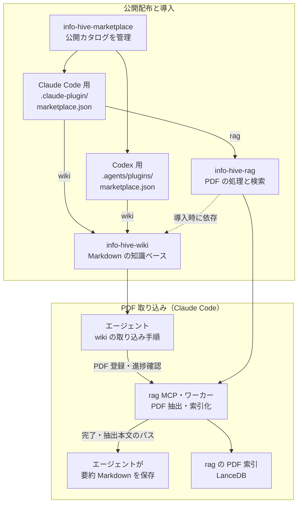

# info-hive の配布と実行の全体図

[[info-hive-marketplace]] がプラグインの取得先を定義し、[[info-hive-wiki]] が Markdown の知識ベースを管理する。[[info-hive-rag]] は PDF の抽出・索引化・検索を担当する。図は marketplace `c709eb3`、wiki `v0.38.1`、rag `4fabe32` の構成を示す。

> Codex 補足: 上段が公開配布、下段が Claude Code の PDF 取り込み。点線は rag が導入時に wiki を必要とすることを表す。下段では wiki の取り込み手順を実行するエージェントが rag を呼び、完了後に抽出本文を読んで wiki に要約を保存する。

## 配布と導入

Claude Code と Codex は、同じ `to884/info-hive-marketplace` リポジトリにあるホスト別のカタログを読む。Claude Code は `.claude-plugin/marketplace.json` の `wiki@info-hive` と `rag@info-hive` をそれぞれの GitHub リポジトリから取得する。Codex は `.agents/plugins/marketplace.json` に載る `wiki@info-hive` を Git URL から取得する。Codex の公開カタログに載るプラグインは wiki のみ。rag の `.claude-plugin/plugin.json` は `wiki@info-hive` への依存を宣言する。[[info-hive-marketplaceの配布構成-c709eb3]]

## PDF 取り込み時の受け渡し

Claude Code で wiki の取り込み手順を実行するエージェントは、rag MCP の `register_pdf` に原本の絶対パスを渡し、`job_status` で進捗を確認する。rag のワーカーは原本の場所を保ったまま読み込み、抽出本文を保存して、自身の PDF 索引を公開する。`completed` を受け取ったエージェントは `result.extracted_markdown` が指すファイルを読み、原本のパス、SHA-256、ジョブ ID を記した要約ページを wiki に作る。[[info-hive-ragのアーキテクチャ-4fabe32]]

PDF 内のチャンクは `rag.search`、wiki の Markdown 記事は `wiki.query` で検索する。[[info-hive-ragのアーキテクチャ-4fabe32]] [[info-hive-wikiのアーキテクチャ-v0.38.1]]
